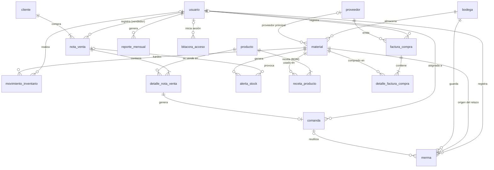

# Base de datos `inventario_irribarra`

MySQL 8.4 LTS · motor InnoDB · `utf8mb4` · 19 tablas · 9 vistas · 15 triggers · 7 procedimientos almacenados.
Scripts en `db/` (se ejecutan en orden con `db/instalar.ps1`).

| Script | Contenido |
|---|---|
| `01_schema.sql` | Tablas, claves primarias y foráneas, índices, restricciones `CHECK` |
| `02_views.sql` | Vistas que alimentan cada pantalla |
| `03_triggers.sql` | Lógica automática de inventario y auditoría |
| `04_procedures.sql` | Transacciones de negocio (`START TRANSACTION … COMMIT / ROLLBACK`) |
| `05_security.sql` | Roles del motor y usuarios de conexión (mínimo privilegio) |
| `06_seed.sql` | Datos iniciales: bodegas, 53 materiales, 2 productos con receta del Excel, usuarios demo |

---

## 1. Esquema (diagrama entidad-relación)

> Para el informe se puede generar la imagen desde **MySQL Workbench**:
> *Database → Reverse Engineer… →* conexión `root` → esquema `inventario_irribarra` → *Execute*.
> Workbench dibuja todas las tablas con sus claves; luego *File → Export → Export as PNG*.



Tablas sin relaciones: `parametro` (medidas mínimas de retazos) y `bitacora_auditoria`
(registra cambios de cualquier tabla con el usuario que los hizo).

### Tablas agregadas al modelo del informe

| Tabla | Por qué |
|---|---|
| `movimiento_inventario` | Kardex: historial de entradas (factura, carga inicial), salidas (fabricación) y ajustes con el saldo resultante. Caso de uso *Consultar inventario (Kardex)*. |
| `bitacora_acceso` | Cada inicio de sesión (OK / FALLIDO / LOGOUT) con IP y fecha. Exigencia de la rúbrica: *datos de registro para acceder*. |
| `bitacora_auditoria` | Valor anterior y nuevo (JSON) de los cambios en materiales, usuarios y notas de venta, con el usuario de la aplicación. |
| `parametro` | Medidas mínimas para que un retazo sea reutilizable (30 cm de largo, 8 cm de ancho). |

---

## 2. Lógica dentro del SGBD

### Triggers

| Trigger | Evento | Qué hace |
|---|---|---|
| `trg_verificar_stock_venta` | AFTER INSERT `detalle_nota_venta` | Recorre la receta × cantidad y crea una alerta **Faltante** por cada material cuyo disponible (stock − comprometido por comandas en espera) no alcanza. Suma el subtotal a la nota. |
| `trg_ingreso_por_factura` | AFTER INSERT `detalle_factura_compra` | Suma el stock, actualiza el costo, escribe el kardex, suma el total de la factura y **resuelve** las alertas que quedan cubiertas. |
| `trg_descuento_stock_fabricacion` | BEFORE UPDATE `comanda` | Controla el Kanban (una etapa a la vez, sin volver a *En espera* desde *Fabricación*). Al pasar a **Fabricación**: los retazos reservados reemplazan 1 unidad cada uno (priorización de sobrantes), descuenta el resto del stock, escribe el kardex y bloquea con `SIGNAL` si falta material. |
| `trg_merma_clasificar` | BEFORE INSERT `merma` | Solo acepta maderas; calcula `supera_minimo`, el valor estimado y marca como *Descartado* lo que no sirve. |
| `trg_merma_validar_estado` | BEFORE UPDATE `merma` | Impide reservar retazos chicos o cambiar uno ya utilizado. |
| `trg_material_after_update` | AFTER UPDATE `material` | Crea/resuelve alertas **Bajo mínimo** y audita el cambio. |
| `trg_material_after_insert` | AFTER INSERT `material` | Audita el alta. |
| `trg_usuario_after_insert` / `_update` | `usuario` | Audita altas y cambios (nunca guarda el hash, solo si la contraseña cambió). |
| `trg_nota_venta_after_update` | AFTER UPDATE `nota_venta` | Audita los cambios de estado. |
| `trg_producto_after_insert` / `_update` | `producto` | Audita altas y cambios de producto (SKU, nombre, precio, estado). |
| `trg_receta_after_insert` / `_update` / `_delete` | `receta_producto` | Audita cada cambio de receta: qué material y qué cantidad, quién y cuándo. |

### Procedimientos almacenados

| Procedimiento | Uso |
|---|---|
| `sp_registrar_nota_venta_json(json, usuario)` | Recibe la nota de la plataforma web (JSON, leído con `JSON_TABLE`), crea/actualiza el cliente, inserta la nota y sus detalles y la aprueba o rechaza: **todo en una transacción**. |
| `sp_procesar_nota_venta(id)` | Vuelve a verificar una nota rechazada (p. ej. después de comprar) y la aprueba creando las comandas. Transacción atómica. |
| `sp_evaluar_nota(id)` | Lógica común de aprobación (la usan los dos anteriores). |
| `sp_registrar_factura_json(json, usuario)` | Registra la factura y sus líneas en una transacción; el trigger suma el stock. |
| `sp_ajustar_stock(material, nuevo, tipo, motivo, usuario)` | Conteo físico / carga inicial con registro en kardex. |
| `sp_sugerir_mermas(comanda)` | Retazos disponibles compatibles con la receta de la comanda. |
| `sp_generar_reporte_mensual(periodo, usuario)` | Consolida consumo valorizado, alertas, ahorro por reciclaje y comandas finalizadas en `reporte_mensual`. |

### Vistas

`v_stock_comprometido`, `v_inventario_estado` (OK / Bajo / Crítico / Sin stock), `v_notas_venta`, `v_kanban_comandas`,
`v_kardex`, `v_alertas`, `v_mermas`, `v_dashboard_kpis`, `v_consumo_mensual_categoria`.

---

## 3. Usuarios que acceden y seguridad

La seguridad funciona en **dos niveles**:

```
Persona ──login──► API (FastAPI) ──conexión según rol──► MySQL
admin              bcrypt + JWT    app_admin      → rol_administrador_bd
ricardo.trab                       app_trabajador → rol_trabajador_bd
```

1. **Aplicación**: tabla `usuario`, contraseñas con hash **bcrypt** (nunca en texto plano), sesión con token JWT de 8 horas,
   pantallas y endpoints restringidos por rol.
2. **Motor**: la API se conecta a MySQL con un usuario distinto según el rol de quien inició sesión. Aunque alguien
   manipulara la aplicación, el motor rechaza lo que su rol no permite (probado: el trabajador recibe
   `DELETE command denied` al intentar borrar un material).

### Usuarios de la aplicación (datos de prueba)

| Usuario | Contraseña | Rol | Acceso |
|---|---|---|---|
| `admin` | `Admin2026!` | Administrador | Todo el sistema |
| `ricardo.trab` | `Taller2026!` | Trabajador | Operación del taller |
| `victor.trab` | `Taller2026!` | Trabajador | Operación del taller |

Las contraseñas de los usuarios de motor (`app_admin`, `app_trabajador`) se generan al azar al instalar y quedan solo
en `backend/.env` (excluido del control de versiones).

### Matriz de privilegios del motor

| Objeto | `rol_administrador_bd` | `rol_trabajador_bd` |
|---|---|---|
| Esquema completo | ALL PRIVILEGES | — |
| `material`, `merma` | ✔ | SELECT, INSERT, UPDATE |
| `comanda` | ✔ | SELECT, UPDATE (mover en Kanban) |
| `producto`, `receta_producto`, `nota_venta`, `detalle_nota_venta`, `cliente`, `bodega`, `proveedor`, `alerta_stock`, `movimiento_inventario`, facturas, `parametro` | ✔ | SELECT (solo lectura) |
| `usuario` | ✔ | SELECT; UPDATE solo de `ultimo_acceso` |
| `bitacora_acceso` | ✔ | INSERT (registrar su login) |
| `bitacora_auditoria`, `reporte_mensual` | ✔ | ✗ |
| DELETE en cualquier tabla | ✔ | ✗ |
| `sp_registrar_factura_json`, `sp_ajustar_stock`, `sp_sugerir_mermas` | ✔ | EXECUTE |
| `sp_registrar_nota_venta_json`, `sp_procesar_nota_venta`, `sp_generar_reporte_mensual` | ✔ | ✗ |
| Vistas de las pantallas del taller | ✔ | SELECT |

### Pantallas por rol

| Pantalla | Administrador | Trabajador |
|---|---|---|
| Dashboard, Comandas (Kanban), Mermas, Compras | ✔ | ✔ |
| Notas de venta | ✔ + simular / aprobar | Solo lectura |
| Materiales | ✔ + alta / edición / baja | Consulta, ajuste por conteo, kardex |
| Productos y recetas, Alertas | ✔ (+ resolver alertas) | Solo lectura |
| Reportes mensuales, Usuarios, Bitácora | ✔ | ✗ (no aparecen en el menú) |

---

## 4. Transacciones y ACID

- Todas las tablas usan **InnoDB** (transacciones, bloqueo por fila, claves foráneas).
- Los procedimientos usan `START TRANSACTION … COMMIT` con `DECLARE EXIT HANDLER FOR SQLEXCEPTION → ROLLBACK; RESIGNAL`.
  Ejemplo probado: una nota con un código de producto inexistente no deja ni la nota ni el cliente a medias.
- `sp_evaluar_nota` bloquea la nota con `SELECT … FOR UPDATE` para que dos usuarios no la aprueben a la vez.
- `CHECK (stock_actual >= 0)` impide stock negativo aunque falle cualquier otra validación.

## 5. Respaldo y recuperación ante fallas

| Acción | Comando |
|---|---|
| Respaldo (estructura + datos + triggers + procedimientos) | `powershell -ExecutionPolicy Bypass -File db\respaldo.ps1` |
| Restaurar el último respaldo | `powershell -ExecutionPolicy Bypass -File db\restaurar.ps1` |
| Restaurar uno específico | `... db\restaurar.ps1 -Archivo db\respaldos\inventario_AAAAMMDD_HHMM.sql` |
| Olvidé la contraseña de root | `db\restablecer_root.ps1` (como administrador) |

- Los respaldos se guardan en `db/respaldos/` y se conservan los 15 más recientes.
- Se recomienda programarlo diario con el **Programador de tareas de Windows**.
- Probado: se borraron 43 materiales, todas las recetas y un trigger; la restauración recuperó todo
  (53 materiales, 76 líneas de receta, 10 triggers, 7 procedimientos).
- Además, MySQL protege cada transacción con el *redo log* (durabilidad) y el *undo log* (rollback).
